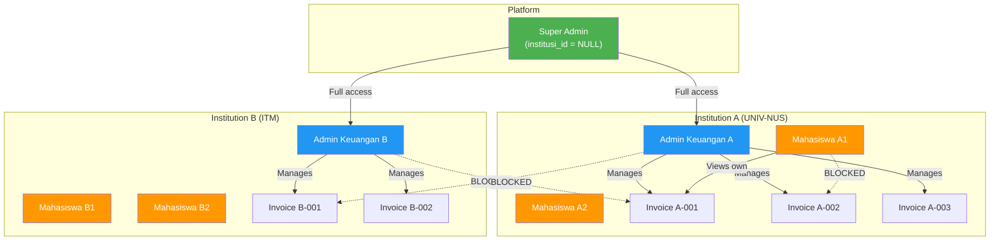

# Entity Relationship Diagram (ERD)
# SEVIMA-PAY: Multi-Tenant UKT Payment System

> **Version**: 1.0.0
> **Database**: PostgreSQL
> **Tenant Isolation**: Row-level via `institusi_id` + PostgreSQL RLS

---

## 1. Full ERD

```mermaid
erDiagram
    INSTITUTIONS {
        uuid id PK
        varchar code UK "Unique institution code"
        varchar name
        text address
        varchar phone
        varchar email
        boolean is_active
        varchar hmac_secret "Encrypted HMAC secret"
        timestamptz created_at
        timestamptz updated_at
    }

    USERS {
        uuid id PK
        uuid institusi_id FK "NULL for super_admin"
        varchar email UK
        varchar password_hash "bcrypt cost 12"
        varchar full_name
        user_role role "super_admin | admin_keuangan | mahasiswa"
        boolean is_active
        timestamptz last_login_at
        timestamptz created_at
        timestamptz updated_at
    }

    STUDENTS {
        uuid id PK
        uuid user_id FK UK "One-to-one with users"
        uuid institusi_id FK
        varchar nim "Unique within institution"
        varchar study_program
        integer enrollment_year
        boolean is_active
        timestamptz created_at
        timestamptz updated_at
    }

    INVOICES {
        uuid id PK
        uuid institusi_id FK
        uuid student_id FK
        varchar invoice_number "Unique within institution"
        bigint amount "Rupiah, no decimals"
        invoice_status status "unpaid | paid | expired"
        semester_type semester "ganjil | genap"
        varchar academic_year "2026/2027"
        date due_date
        timestamptz paid_at
        bigint paid_amount
        varchar payment_method
        text notes
        timestamptz created_at
        timestamptz updated_at
    }

    TRANSACTION_HISTORIES {
        uuid id PK
        uuid invoice_id FK
        uuid institusi_id FK
        invoice_status previous_status
        invoice_status new_status
        bigint amount
        varchar source "webhook | manual | system_expiry"
        varchar source_ref "webhook_log.id or user.id"
        text notes
        timestamptz created_at "Append-only, no update"
    }

    WEBHOOK_LOGS {
        uuid id PK
        uuid institusi_id FK "NULL if institution not found"
        webhook_event_type event_type
        varchar invoice_number
        varchar institution_code
        jsonb raw_payload
        jsonb raw_headers
        varchar signature
        webhook_log_status processing_status
        text error_message
        inet ip_address
        timestamptz processed_at
        timestamptz created_at
    }

    REFRESH_TOKENS {
        uuid id PK
        uuid user_id FK
        varchar token_hash UK "SHA-256 of actual token"
        timestamptz expires_at
        timestamptz revoked_at
        timestamptz created_at
    }

    INSTITUTIONS ||--o{ USERS : "has many"
    INSTITUTIONS ||--o{ STUDENTS : "has many"
    INSTITUTIONS ||--o{ INVOICES : "has many"
    INSTITUTIONS ||--o{ TRANSACTION_HISTORIES : "has many"
    INSTITUTIONS ||--o{ WEBHOOK_LOGS : "has many"
    USERS ||--o| STUDENTS : "has profile"
    USERS ||--o{ REFRESH_TOKENS : "has many"
    STUDENTS ||--o{ INVOICES : "has many"
    INVOICES ||--o{ TRANSACTION_HISTORIES : "has many"
```

---

## 2. Tenant Isolation Diagram



---

## 3. Key Constraints & Rules

### 3.1 Unique Constraints

| Table | Constraint | Scope |
|-------|-----------|-------|
| `institutions` | `code` | Global |
| `users` | `email` | Global |
| `students` | `(institusi_id, nim)` | Per institution |
| `invoices` | `(institusi_id, invoice_number)` | Per institution |
| `refresh_tokens` | `token_hash` | Global |

### 3.2 Check Constraints

| Table | Constraint | Rule |
|-------|-----------|------|
| `users` | `chk_users_super_admin_no_institusi` | Super admin → NULL institusi_id; others → NOT NULL |
| `invoices` | `chk_invoices_amount_positive` | amount > 0 |
| `invoices` | `chk_invoices_paid_consistency` | paid → paid_at NOT NULL |
| `invoices` | `chk_invoices_academic_year_format` | Format YYYY/YYYY |
| `transaction_histories` | `chk_txn_status_changed` | previous != new status |

### 3.3 Indexes Strategy

| Purpose | Index | Type |
|---------|-------|------|
| Tenant filtering | `idx_*_institusi_id` | B-tree on every tenant-scoped table |
| Login lookup | `idx_users_email` | B-tree |
| Invoice search | `idx_invoices_institusi_status` | Composite B-tree |
| Expiry checker | `idx_invoices_unpaid_due` | Partial (WHERE status = 'unpaid') |
| Audit timeline | `idx_txn_histories_created_at` | B-tree |
| Active tokens | `idx_refresh_tokens_active` | Partial (WHERE revoked_at IS NULL) |

### 3.4 Row-Level Security (RLS)

Every tenant-scoped table has RLS enabled with policies that check:

```sql
-- Session variable set by application per request
SET app.current_institusi_id = '<user_institusi_id>';
SET app.current_role = '<user_role>';

-- Policy logic (simplified)
USING (
    institusi_id = current_setting('app.current_institusi_id')::UUID
    OR current_setting('app.current_role') = 'super_admin'
)
```

---

## 4. Data Types Rationale

| Column | Type | Rationale |
|--------|------|-----------|
| IDs | `UUID` | No sequential guessing, safe for multi-tenant |
| Money | `BIGINT` | Rupiah has no decimals; avoids floating-point errors |
| Timestamps | `TIMESTAMPTZ` | Timezone-aware, critical for distributed systems |
| Payload | `JSONB` | Flexible schema for gateway payloads, indexable |
| IP Address | `INET` | PostgreSQL native type, supports both IPv4 and IPv6 |
| Status fields | `ENUM` | Type-safe, self-documenting, enforced at DB level |

---

## 5. Triggers Summary

| Trigger | Table | Action | Purpose |
|---------|-------|--------|---------|
| `set_updated_at_*` | institutions, users, students, invoices | BEFORE UPDATE | Auto-set `updated_at` |
| `prevent_txn_history_update` | transaction_histories | BEFORE UPDATE | Enforce append-only |
| `prevent_txn_history_delete` | transaction_histories | BEFORE DELETE | Enforce append-only |

---

## 6. Functions Summary

| Function | Purpose | Caller |
|----------|---------|--------|
| `trigger_set_updated_at()` | Auto-update timestamps | Triggers |
| `prevent_txn_history_modification()` | Block modifications to audit trail | Triggers |
| `expire_overdue_invoices()` | Batch expire unpaid invoices past due date | Scheduled job / cron |
