# Sequence Diagrams
# SEVIMA-PAY: Multi-Tenant UKT Payment System

> **Version**: 1.0.0
> Semua diagram menggunakan Mermaid syntax

---

## 1. Authentication Flow

### 1.1 Login

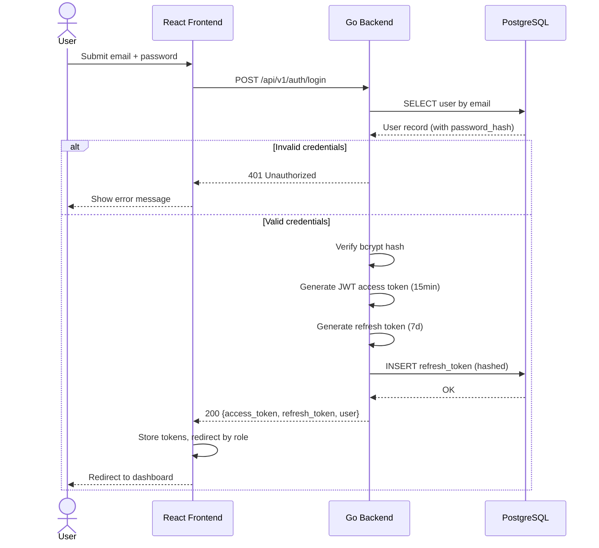

### 1.2 Token Refresh

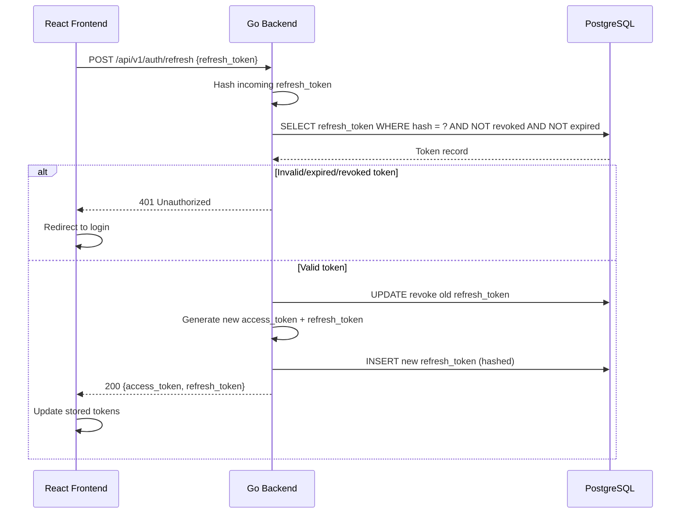

### 1.3 Logout

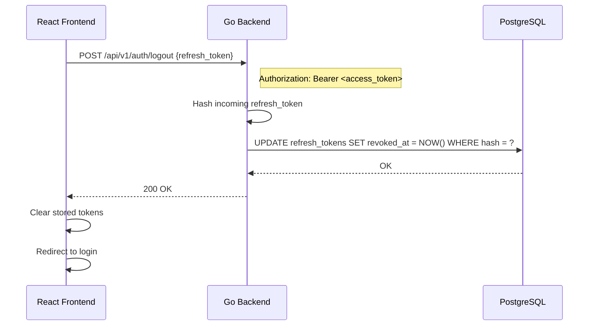

---

## 2. Invoice Management Flow

### 2.1 Create Invoice (Admin Keuangan)

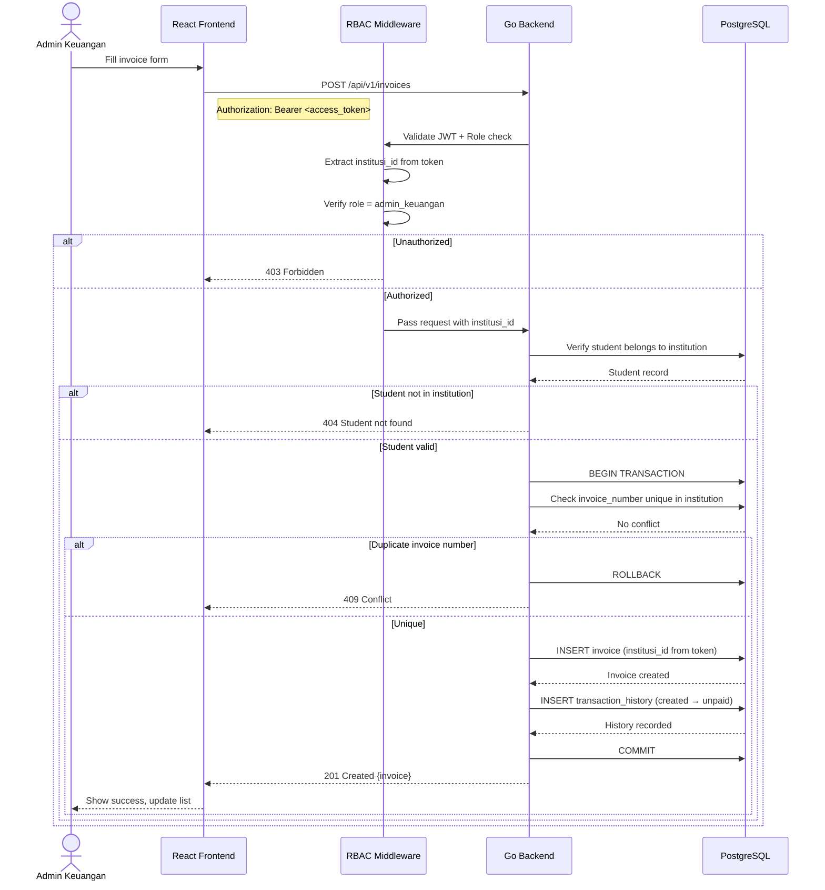

### 2.2 List Invoices with Filters (Admin Keuangan)

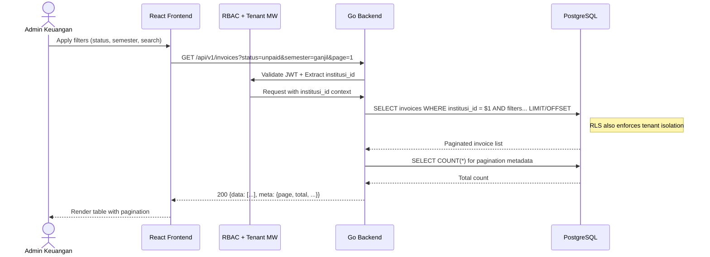

---

## 3. Webhook Payment Flow

### 3.1 Payment Success (Happy Path)

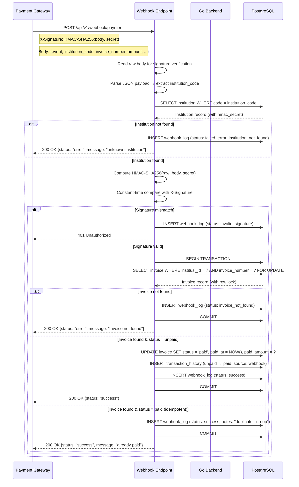

### 3.2 Payment Expired

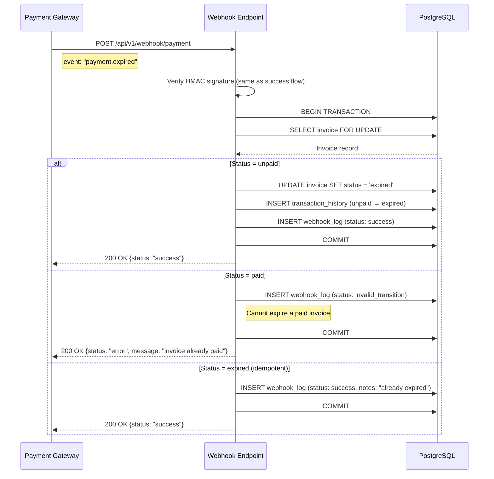

### 3.3 Concurrent Webhook Processing

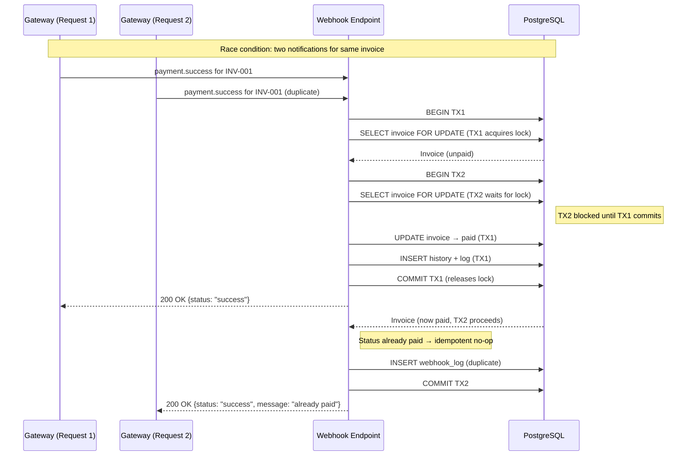

---

## 4. Student View Flow

### 4.1 View Invoices & Transaction History

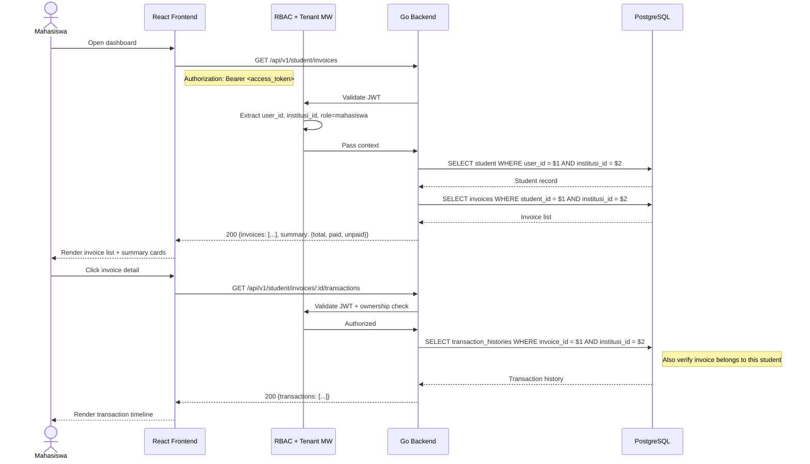

---

## 5. Mock Gateway Flow

### 5.1 Trigger Webhook from Mock UI

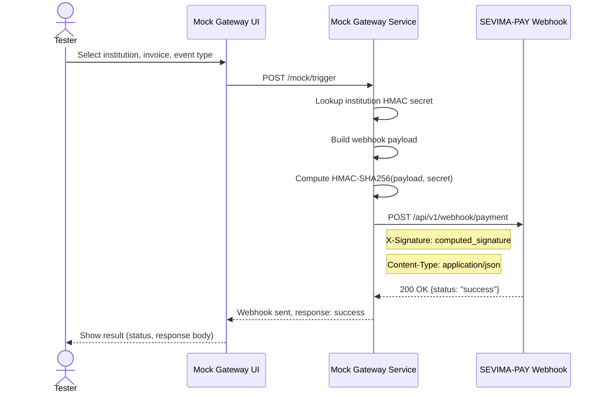

---

## 6. Scheduled Invoice Expiry

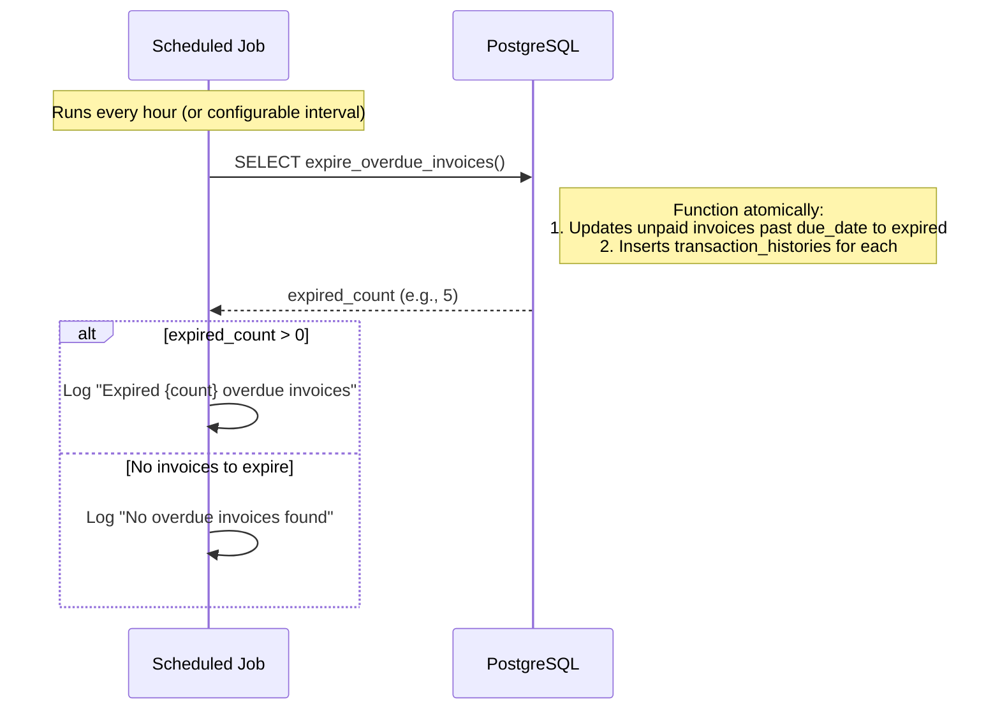

---

## 7. RBAC Middleware Pipeline

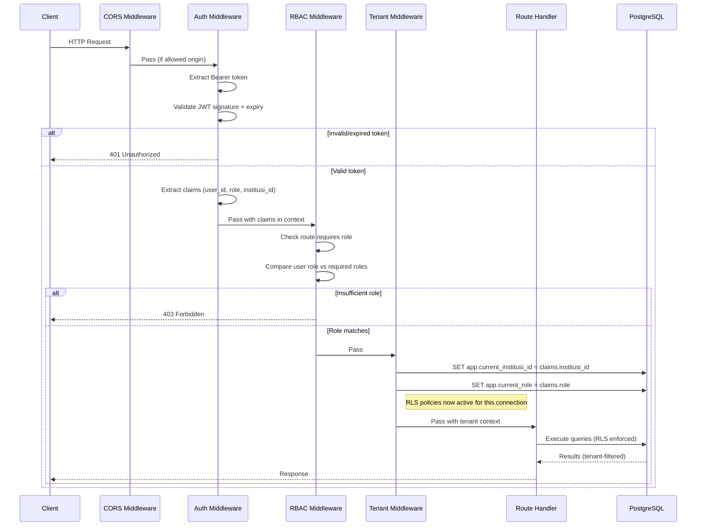
