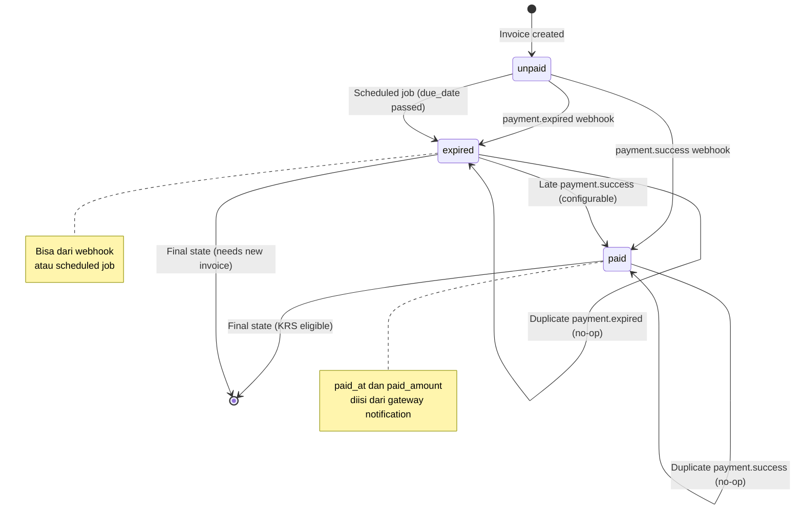
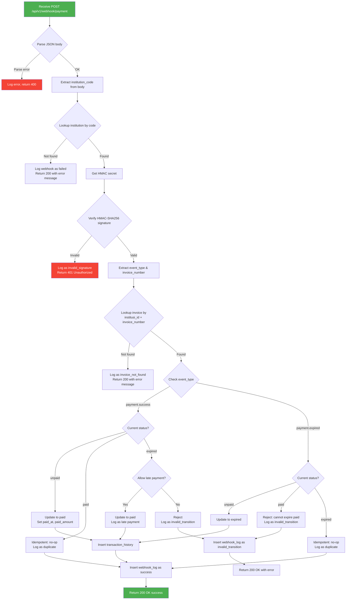
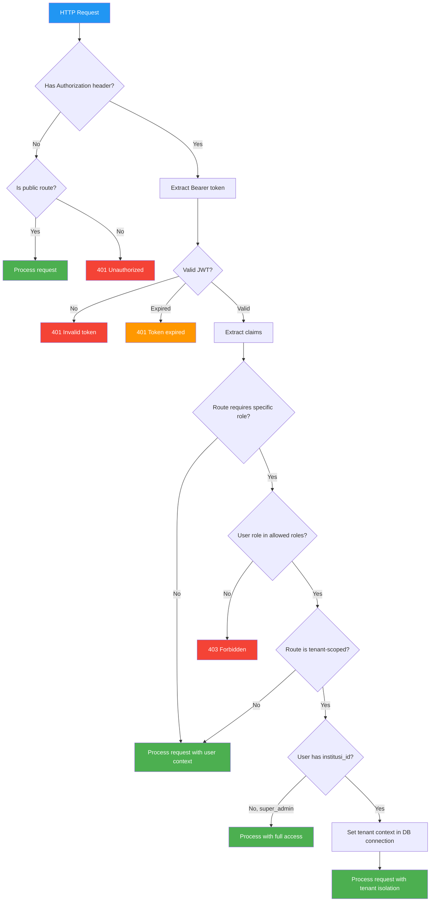
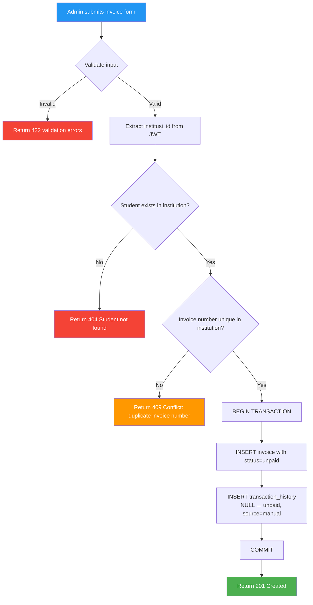
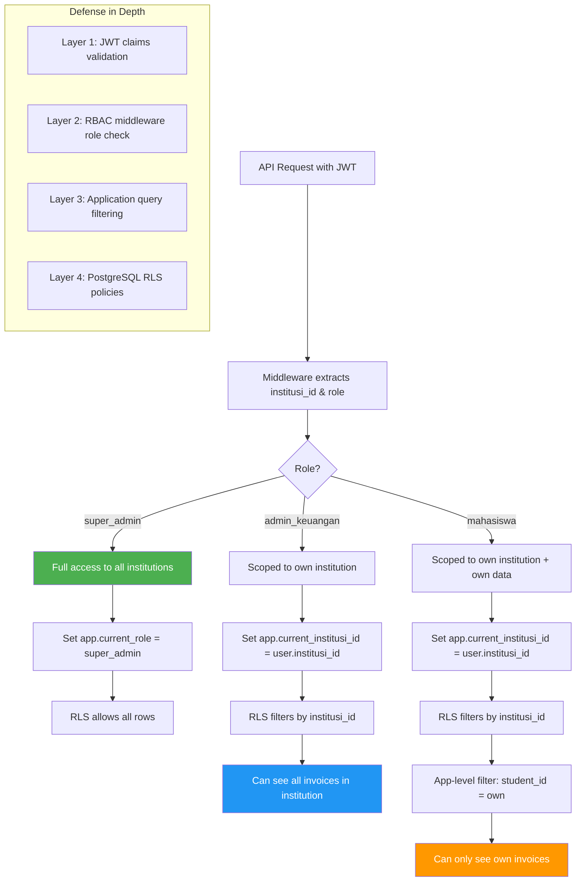
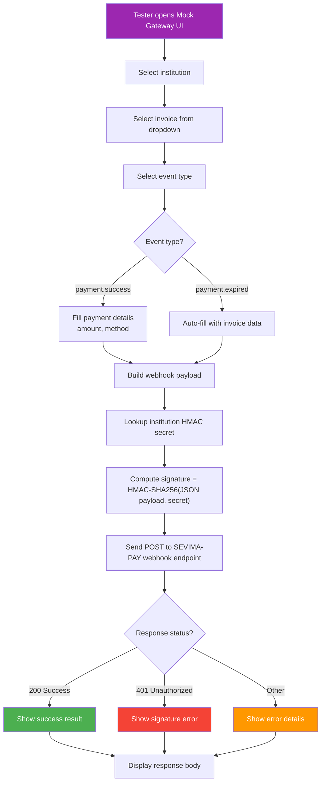
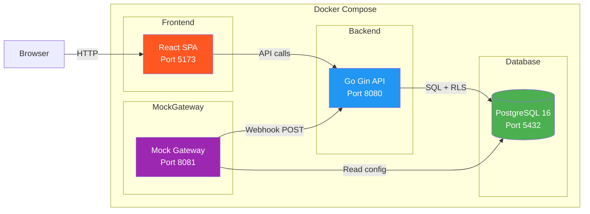
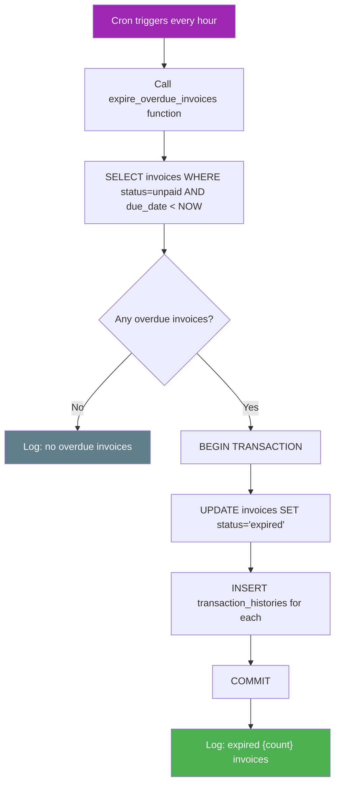
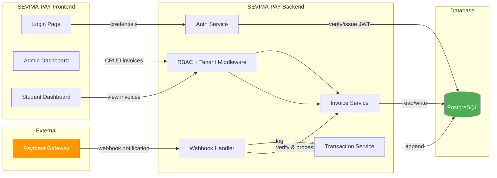

# Flow Diagrams
# SEVIMA-PAY: Multi-Tenant UKT Payment System

> **Version**: 1.0.0
> Semua diagram menggunakan Mermaid syntax

---

## 1. Invoice Lifecycle State Machine

---

## 2. Webhook Processing Flowchart

---

## 3. Authentication & Authorization Flow

---

## 4. Invoice Creation Flow

---

## 5. Tenant Data Access Control Flow

---

## 6. Mock Payment Gateway Flow

---

## 7. System Deployment Architecture

---

## 8. Scheduled Expiry Job Flow

---

## 9. Data Flow Overview

